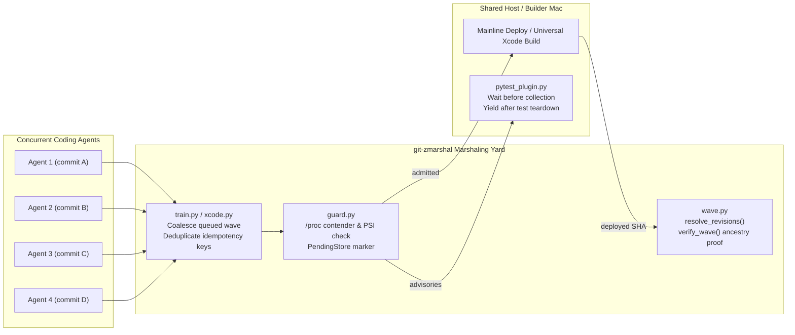

# git-zmarshal

**Z-scale Git deploy and Xcode build marshaling yard for multi-agent coding hosts.**

When half a dozen coding agents merge into `main` faster than a single server or developer Mac can build, test and deploy, triggering a fresh pipeline on every commit creates a queue of obsolete builds. Meanwhile, `pytest`, database backups and container or Xcode builds compete for the same CPU and disk I/O, and callers cannot tell whether their commit actually landed in the running deployment.

You do not need hyperscale orchestration infrastructure or a custom version control system to solve that scheduling problem. **`git-zmarshal`**—named after **Z scale** (1:220, the smallest model railway gauge, in contrast to hyperscale multi-agent infrastructure like Anthropic's Scion) and **railway marshaling yards**—provides small, zero-dependency Python building blocks and a native `git zmarshal` subcommand for standard Git repositories:

1. **Coalesce $N$ overlapping merges into $< N$ deploy waves (`train`):** while Wave 1 is running on the mainline, arriving commits coupled in the marshaling yard accumulate in a single queued Wave 2 that resolves the latest revision at departure.
2. **Admit heavy work only when the host has capacity (`guard`):** scan `/proc` contenders (`pytest`, `pg_dump`, `restic`, `git gc`), exempt containerised CI cgroups (`docker-*.scope`, `containerd`, `kubepods`, `actions_job`), check CPU load, swap and Linux PSI pressure, and write process-safe advisory pending markers.
3. **Yield `pytest` cooperatively (`pytest_plugin`):** new test runs wait before collection when a deploy is pending; in-flight serial test suites stop cleanly after fixture teardown with pytest's interrupted exit code (`2`) so partial runs never masquerade as green.
4. **Verify multi-commit waves fail-closed (`wave`):** freeze branch/ref names before submission and prove every coalesced commit is an ancestor of the deployed revision via `git --no-replace-objects merge-base --is-ancestor`, rejecting shallow-clone false negatives and prefix collisions.
5. **Marshal Apple / Xcode device builds (`xcode`):** coalesce `ios`, `ipad` and `watch` requests onto a single universal compile lane (`TARGETED_DEVICE_FAMILY=1,2`) and fan out `devicectl` installs across physical devices.



---

## Install & Quickstart

Requires **Python 3.10+** and **Git**. The library has **zero runtime Python dependencies**.

```sh
python -m pip install .
# Include pytest for the optional plugin and test suite:
python -m pip install '.[pytest,test]'
```

Because the CLI executable is named `git-zmarshal`, Git automatically exposes it as `git zmarshal` when installed on your `PATH`:

```sh
# Run a self-contained simulation of 5 concurrent agents in a temporary Git repo:
git zmarshal demo

# Emit structured JSON from the simulation:
git zmarshal demo --json

# Freeze branch or short refs to full commit hashes:
git zmarshal resolve main HEAD~1 --repo /path/to/repo

# Prove that multiple commits are ancestors of a deployed revision:
git zmarshal verify <deployed-sha> <commit-a> <commit-b> --repo /path/to/repo

# Inspect host admission (/proc contenders, load, swap, PSI) and pending markers:
git zmarshal guard --max-load-per-cpu 1.5 --max-swap-ratio 0.5 --pressure-limit 20

# Interleave services across shared lock groups:
git zmarshal plan-wave api worker beat --group api=app --group worker=app
```

---

## Modules and boundaries

| Module | Responsibility |
| --- | --- |
| `git_zmarshal.train` | Pure coalescing policy and request/audit metadata updates |
| `git_zmarshal.guard` | `/proc` contender scanning, cgroup exemptions, load/swap/pressure checks, atomic advisory markers |
| `git_zmarshal.pytest_plugin` | Cooperative startup waiting and yielding after test teardown |
| `git_zmarshal.wave` | Service ordering, immutable commit resolution and multi-commit ancestry proofs |
| `git_zmarshal.xcode` | Universal Xcode lane normalisation (`ios`/`ipad`/`watch`), multi-device install fan-out and build queue wave coalescing |
| `git_zmarshal.cli` | `git-zmarshal` / `git zmarshal` CLI (`demo`, `verify`, `resolve`, `guard`, `plan-wave`) |

> [!NOTE]
> For backwards compatibility with earlier extractions, `git_deploy_train` is also installed as a re-export alias of `git_zmarshal`. Importing either package performs no I/O or global registration.

The package does not supply a deployment daemon, database, HTTP server, build system or platform-specific deployment scripts. Your adapter owns persistence, transactions, authentication, service locks, source checkout, process execution, recovery, health verification and rollback.

---

## Train planner and policy (`git_zmarshal.train`)

```python
from git_zmarshal.train import (
    DeployTrainPolicy,
    add_train_request,
    merge_deploy_result,
    plan_deploy_enqueue,
)

policy = DeployTrainPolicy(window_seconds=5, request_limit=200)

# High-level planner: decides whether an incoming deploy request deduplicates,
# joins a running wave, coalesces into a queued wave, or inserts a new wave:
plan1 = plan_deploy_enqueue(
    [],
    policy=policy,
    service="api",
    actor="agent-one",
    reason="merge B",
    idempotency_key="first-request",
    revision="commit-b",
)
assert plan1.action == "insert" and plan1.train_step == "started"

plan2 = plan_deploy_enqueue(
    [plan1.job],
    policy=policy,
    service="api",
    actor="agent-two",
    reason="merge C",
    idempotency_key="second-request",
    revision="commit-c",
)
assert plan2.action == "join_queued"
assert plan2.job["coalesced_count"] == 2
assert plan2.job["expected_revisions"] == ["commit-b", "commit-c"]

# Preserve server-owned train metadata when merging a worker's terminal result:
final_job = merge_deploy_result(
    plan2.job,
    {"status": "succeeded", "deployed_revision": "commit-c"},
)
assert final_job["coalesced_count"] == 2
assert final_job["deployed_revision"] == "commit-c"
```

Use `plan_deploy_enqueue(...)` (which mirrors `plan_xcode_enqueue(...)` for server/container deployments) or lower-level `policy.eligible(...)` + `add_train_request(...)`. A request attaches to a running wave only when both revisions are known and equal and the running wave is not stale (`stale_running_timeout_seconds`, default 3600s). An accepted reservation is already departing: its checkout may be changing, so new requests belong in a queued wave.

`add_train_request` returns a copied record; repeated idempotency keys do not increment its count. It keeps every `coalesced_idempotency_keys` and `expected_revisions` entry even when `train_requests` audit history reaches its bound. Index those keys in your durable store for retries after completion. A queued source revision is an observation, not a pin: concurrent fetches can arrive out of order, so resolve again at departure. A running source revision remains immutable.

---

## Host admission and pending markers (`git_zmarshal.guard`)

```python
from pathlib import Path
from git_zmarshal.guard import GuardConfig, HostAdmissionGuard, PendingStore

guard = HostAdmissionGuard(GuardConfig(
    proc_root=Path("/proc"),
    max_load_per_cpu=1.5,
    max_swap_used_ratio=0.5,
    pressure_limit=20,
    include_xcode_programs=True,
))
pending = PendingStore("/tmp/git-zmarshal-pending")
verdict = guard.check()
if not verdict.ok:
    pending.record("api", {"action": "deploy"}, actor="ci", holds=verdict.holds,
                   owner_id="wave-42")
# After this wave and all its admission work have finished:
pending.clear("api", owner_id="wave-42")
```

The scanner recognises actual executable names and Python entrypoints, not words embedded in shell arguments. It identifies test runs (`pytest`), backup tools (`pg_dump`, `pg_dumpall`, `pg_basebackup`, `restic`), Git maintenance (`gc`, `prune`, `repack`, `pack-objects`, `fsck`), and—when `include_xcode_programs=True`—Apple build tools (`xcodebuild`, `swift-frontend`). On Linux it reads `/proc` (`cmdline`, `cgroup`, `loadavg`, `meminfo`, `pressure/*`); on macOS/POSIX hosts without `/proc`, it automatically falls back to `ps -axo pid=,args=`, `os.getloadavg()`, and `sysctl vm.swapusage`. Resource thresholds are disabled until configured, and the scanner tolerates processes disappearing between reads.

Pytest within recognised `docker-*.scope`, `containerd`, `kubepods` or `actions_job` cgroups is exempt from the test contender check. Additional component names can be configured with `admitted_cgroup_components`. Host pressure checks still apply. The guard is advisory scheduling, not a security boundary: missing or unreadable telemetry fails open.

`PendingStore` uses one marker per service. `PendingFlag` offers a single `deploy-pending.json` with `record(job_id, service=...)`, `read()` and `clear(job_id)`. Both use atomic replacement and a stable sidecar file lock (`fcntl.flock`). Always clear with the owning wave ID; an earlier wave must not erase a newer wave's signal.

---

## Cooperative pytest handshake (`git_zmarshal.pytest_plugin`)

```sh
export GIT_ZMARSHAL_PENDING_DIR=/run/git-zmarshal/pending
python -m pytest -p git_zmarshal.pytest_plugin
```

New runs wait before collection, re-executing into a lightweight waiter process that does not appear as an active `pytest` contender in `/proc`. If a marker appears during a suite, the `pytest_runtest_makereport` hook requests a controlled stop **after test teardown**. The incomplete suite exits with pytest's interrupted status (`2`), not success, so your test runner knows to retry it. Running tests are never force-killed.

| Environment variable | Meaning |
| --- | --- |
| `GIT_ZMARSHAL_PENDING_DIR` | Marker directory; default `/run/git-zmarshal/pending` (also checks its `trains/` child; legacy `GIT_DEPLOY_TRAIN_PENDING_DIR` also honoured) |
| `GIT_ZMARSHAL_PENDING_FILE` | Optional additional single flag file |
| `GIT_ZMARSHAL_MAX_WAIT` | Startup wait cap in seconds; default 900, maximum 3600 |
| `GIT_ZMARSHAL_BYPASS=1` | Explicitly bypass startup waiting and mid-suite yielding |

The package deliberately registers no automatic `pytest11` entry point, so installing `git-zmarshal` never alters unrelated test runs unless `-p git_zmarshal.pytest_plugin` is passed.

---

## Verify a multi-commit wave (`git_zmarshal.wave`)

```python
from git_zmarshal.wave import plan_wave, resolve_revisions, verify_wave

# Interleave services across shared lock groups:
assert plan_wave(["api", "worker", "docs"], {"api": "core", "worker": "core"}) == [
    "api", "docs", "worker"
]
```

To verify that every commit in a coalesced wave landed in the deployed revision:

```python
from git_zmarshal.wave import resolve_revisions, verify_wave

# Freeze names before submission so a moving branch cannot change the request:
expected = resolve_revisions("/srv/repo", ["feature-one", "feature-two"])
# Obtain this value from your deployment/runtime provenance adapter:
deployed_commit = "0123456789abcdef0123456789abcdef01234567"
proof = verify_wave("/srv/repo", expected, deployed_commit, timeout=10)
if not proof.ok:
    for result in proof.results:
        print(result.revision, result.status, result.detail)
```

Every expected revision must resolve to a commit object (`rev-parse --verify --end-of-options <rev>^{commit}`). The verifier resolves the deployed revision once, then runs `git --no-replace-objects merge-base --is-ancestor` for each expected commit. Results are `equal`, `ancestor`, `not-ancestor` or `unknown`. Only `equal` and `ancestor` pass. Matching text prefixes are never sufficient evidence. Missing or ambiguous objects, invalid revisions, Git failures/timeouts and negative checks in shallow repositories return `unknown`.

---

## Xcode and Apple device build trains (`git_zmarshal.xcode`)

```python
from git_zmarshal.xcode import (
    merge_xcode_result,
    normalise_git_ref,
    plan_xcode_enqueue,
    xcode_build_lane,
)

# Universal apps share one compile lane across iPhone, iPad and embedded Watch:
assert xcode_build_lane("ios") == "universal-app"
assert xcode_build_lane("ipad") == "universal-app"
assert xcode_build_lane("watch") == "universal-app"

plan = plan_xcode_enqueue(
    active_jobs=[
        {
            "id": "job-1",
            "status": "queued",
            "target": "ios",
            "job_type": "install",
            "git_ref": "origin/main",
            "result": {},
        }
    ],
    target="ipad",
    job_type="install",
    git_ref="refs/heads/main",
    actor="agent-2",
    reason="verify iPad layout",
)
assert plan.action == "join_queued"
assert plan.train["device_kinds"] == ["iphone", "ipad"]
```

Physical-device Xcode builds are single-flight bottlenecks on a developer Mac: compiling one universal scheme (`TARGETED_DEVICE_FAMILY=1,2`) once and running `xcrun devicectl device install app` across every requested device kind (`iphone`, `ipad`) cuts duplicate compilations in half while coalescing $N$ concurrent agent merges into fewer than $N$ Xcode builds.

Key invariants in `git_zmarshal.xcode`:

- **Configurable universal lane (`xcode_build_lane` / `canonical_xcode_lane`)**: maps `ios`, `ipad` and `watch` onto a single universal compile lane (default `"universal-app"`, customisable via `universal_lane` and `universal_targets`), while keeping standalone watch simulator gates (`("watch", "compile-check")`) and separate app schemes on independent lanes.
- **Ref normalisation (`normalise_git_ref`)**: strips `origin/`, `refs/heads/` and `refs/remotes/origin/` prefixes and lowercases 40-hex commit SHAs so equivalent branch spellings (`None`, `"main"`, `"origin/main"`, `"refs/heads/main"`) coalesce onto the same queued wave, while distinct feature branches never collide.
- **Claimed-job safety (`can_join_claimed_xcode_job`)**: an in-flight `claimed` build is shared only when its required device kinds already cover the incoming request and its authoritative checked-out commit (`result.commit` or `result.train.resolved_commit`) matches the caller's `expected_revision` or 40-hex `git_ref`.
- **Stale-claim filtering**: `plan_xcode_enqueue` ignores `claimed` jobs older than `stale_claim_timeout_seconds` (default 2700s / 45m) so callers never attach to an abandoned worker claim.
- **Isolation (`coalesce=False`)**: passing `coalesce=False` records `result.train.isolated = True` on the queued job so neither that request nor subsequent requests coalesce with it.
- **Server-owned result merge (`merge_xcode_result`)**: preserves server-side `result.train` metadata across worker status updates while promoting worker `commit` (`resolved_commit`), `installed_devices` and `installed_udids`.

---

## Reference SQLite + subprocess runner (`examples/minimal_yard.py`)

For a drop-in single-host deploy runner that ties `DeployTrainPolicy`, `HostAdmissionGuard`, `PendingStore` and `verify_wave` together around `sqlite3` (`BEGIN IMMEDIATE` transactions) and `subprocess.run`, see [`examples/minimal_yard.py`](examples/minimal_yard.py):

```sh
python examples/minimal_yard.py --demo
```

It implements atomic reserve/coalesce across active and completed waves, records owner-tagged pending markers when held by `/proc` contenders, resolves `HEAD` at departure while releasing SQLite locks before subprocess I/O, and verifies every coalesced commit against the deployed revision.

---

## Two-way monorepo sync (`scripts/sync_monorepo.py`)

`git-zmarshal` is maintained in two-way lockstep with `packages/git-deploy-train` inside the Cortex monorepo, with `src/git_deploy_train/` mirrored as a self-contained zero-dependency package so isolated daemons (`python3 -I -S`) can load modules directly from disk:

```sh
# Verify byte-for-byte shim parity and isolated python3 -I -S loading:
python scripts/sync_monorepo.py --check

# Push standalone upgrades into a monorepo checkout:
python scripts/sync_monorepo.py --push-to-monorepo --monorepo /path/to/monorepo

# Pull monorepo improvements back into the standalone repo:
python scripts/sync_monorepo.py --pull-from-monorepo --monorepo /path/to/monorepo
```

---

## Tests and licence

Run the portable test suite from this directory:

```sh
python -m pytest -v
```

Tests create temporary Git repositories and synthetic `/proc` trees and require no external services.

MIT; see [LICENSE](LICENSE).

